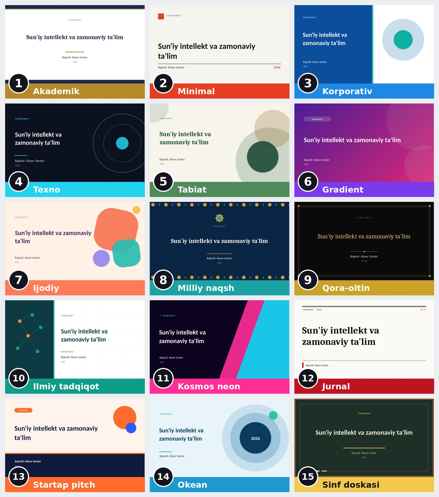

# 🎓 Academic AI Bot

Talabalar uchun Telegram bot: taqdimot, kurs ishi, maqola, mustaqil ish, konspekt, imtihonga tayyorlov va boshqa
o'quv hujjatlarini sun'iy intellekt yordamida bir necha daqiqada tayyorlab beradi.

- **Tillar:** o'zbekcha, ruscha, inglizcha
- **AI:** DeepSeek (matn yaratish) va Google Gemini (rasm, PDF o'qish, masala yechish)
- **Natija:** tahrirlanadigan Word (.docx) va PowerPoint (.pptx) fayllar



---

## 📋 Mundarija

- [Xizmatlar](#-xizmatlar)
- [Taqdimot shablonlari](#-taqdimot-shablonlari)
- [Loyiha tuzilishi](#-loyiha-tuzilishi)
- [O'rnatish va ishga tushirish](#-ornatish-va-ishga-tushirish)
- [Sozlamalar (.env)](#%EF%B8%8F-sozlamalar-env)
- [Tanga tizimi](#-tanga-tizimi)
- [Admin buyruqlari](#-admin-buyruqlari)
- [Xavfsizlik](#-xavfsizlik)
- [Serverga joylash](#-serverga-joylash)

---

## ✨ Xizmatlar

Narxlar tangada (🪙). Admin uchun barcha xizmatlar bepul.

### Hujjatlar

| Xizmat | Narx | Natija |
|---|---|---|
| 📊 Taqdimot | 5 | 15 ta shablondan biri bilan PowerPoint taqdimot: diagrammalar, jadvallar, bosqichlar |
| 📄 Kurs ishi (standart) | 12 | 25–30 bet: kirish, 2 bob (6 paragraf), xulosa va takliflar, 15–20 adabiyot |
| 📚 Kurs ishi (kengaytirilgan) | 25 | 65–70 bet: kirish, 3 bob (9 paragraf), ko'proq jadval va grafiklar, 25–35 adabiyot |
| 🗂 Mustaqil ish | 6 | Titul, reja, 3 bob, xulosa va **GOST / APA / MLA** formatidagi adabiyotlar ro'yxati |
| 📑 Referat | 5 | 8–12 betlik referat |
| 📰 Maqola | 8 | IMRAD formatidagi ilmiy maqola |
| 📋 Tezis | 5 | Konferensiya tezisi |

### O'qish va imtihon

| Xizmat | Narx | Natija |
|---|---|---|
| 📚 Konspekt | 4 | Matn, Word, PDF yoki rasmdan konspekt: qisqa mazmun, asosiy g'oyalar, atamalar lug'ati, savollar |
| 🎯 Imtihonga tayyorlov | 5 | Flash-kartalar, 10 ta test (Telegram ichida interaktiv quiz), ehtimoliy savollar, kunlik reja |
| 🧮 Masala yechish | 3 | Rasm yoki matndagi masalani bosqichma-bosqich yechish: matematika, fizika, **kimyoviy reaksiyalar**, **biologik sxemalar** (qo'lda yozilgan yoki skaner) |
| 🧪 Test savollari | 4 | Mavzu bo'yicha test savollari |
| 🧠 Test markazi: materialdan test | 4 | PDF darslik, Word, rasm yoki matndan test: kerakli **betlar yoki bob** bo'yicha, 10/20/30 savol, daraja tanlash. **Namuna test** yuborilsa, savollar aynan o'sha formatda tuziladi (namuna Word bo'lsa — uning sahifa sozlamalari va kolontitullari bilan). Oq toza Word + Telegram ichida interaktiv test |
| 🎯 Test markazi: tayyor test → quiz | 2 | Tayyor testni (Word, PDF, rasm, matn) Telegram quizga aylantiradi; guruhga forward qilsa talabalar ham yechadi |
| 🎧 Ovozli matn | 2 | Matn, fayl yoki rasmni MP3 audioga aylantirish (o'zbek, rus, ingliz, qozoq, turk ovozlari). Konspekt va mustaqil ish ostida "Ovozli tinglash" tugmasi bor |

### Matn bilan ishlash

| Xizmat | Narx | Natija |
|---|---|---|
| 🌐 Tarjima | 3 | Matn yoki rasmdagi matnni tarjima qilish |
| ✍️ Grammatika | 2 | Imlo va grammatik xatolarni tuzatish |
| 🔄 Originallashtirish | 6 | Matnni qayta ifodalash |
| 📝 Esse tekshirish | 5 | Esse bo'yicha baho va tavsiyalar (PDF hisobot) |

### Boshqa

| Xizmat | Narx | Natija |
|---|---|---|
| 🎤 Nutq | 4 | Ma'ruza/chiqish uchun nutq matni |
| 🗣 Spiker nutqi | 4 | Taqdimot faylidan spiker matni |
| 💼 CV | 6 | Rezyume (Word) |
| 🔬 Gipoteza | 5 | Ilmiy muammo va gipoteza shakllantirish |
| 🧑‍🏫 Sinf sardori | 4 | Yig'ilish bayonnomasi, tadbir ssenariysi, tarbiyaviy soat rejasi, e'lon/taklifnoma, faoliyat hisoboti |

Tayyor hujjatni bot ichida **tahrirlash** ham mumkin ("✏️ Hujjatni tahrirlash" tugmasi).

---

## 🎨 Taqdimot shablonlari

Foydalanuvchi slaydlar sonini kiritgandan keyin 15 ta shablonning rasmli galereyasini ko'radi.
Rasmlardagi katta raqam tanlash tugmalaridagi raqam bilan bir xil.

Shablonlar faqat rangi bilan emas, **maketi** bilan ham farq qiladi:

| Slayd turi | Variantlar |
|---|---|
| Titul | 15 xil |
| Sarlavha | ostiga chiziq, rangli tasma, chap ustun, raqamli, yorliqli, markaziy naqsh va boshqalar (9 xil) |
| Statistika | vertikal ustun, gorizontal ustun, chiziqli grafik, maydon grafik, progress-chiziqlar, lollipop |
| Taqsimot (foizlar) | doughnut, doira, 100% tasma, waffle 10×10, pufakchalar, halqalar |
| Ro'yxat | qatorlar, kartalar, ikonka ustunlari, tabletkalar, zigzag, katta raqamlar |
| Reja | ustunlar, tugunlar, pog'onali yorliqlar, chap panel, vertikal raqamlar |
| Bosqichlar | gorizontal, vertikal, strelkalar, zinapoya |
| Jadval, taqqoslash, statistika kartalari, xulosa | 4 xildan |

Diagrammalar PowerPoint'ning haqiqiy diagrammalari, ya'ni raqamlarni keyin o'zingiz tahrirlay olasiz.

**Taqdimot tili** interfeys tilidan alohida tanlanadi: o'zbek (lotin va kirill), qoraqalpoq, rus, ingliz, qozoq,
qirg'iz, tojik, turk, nemis.

**O'z shabloningiz:** galereyadagi "📎 O'z shablonimni yuklayman" tugmasi orqali istalgan PowerPoint shablonini (.pptx)
yuborish mumkin — bot uning foni, bezaklari, ranglari va shriftlarini saqlab, ichini to'ldiradi.
Har bir slaydda sarlavha ostida slaydning asosiy fikrini tushuntiruvchi izoh bor.

Shablonlar ro'yxati: Akademik, Minimal, Korporativ, Texno, Tabiat, Gradient, Ijodiy, Milliy naqsh, Qora-oltin,
Ilmiy tadqiqot, Kosmos neon, Jurnal, Startap pitch, Okean, Sinf doskasi.

---

## 📁 Loyiha tuzilishi

```
Academic_ai_bot/
├── bot.py                # Asosiy bot: menyu, xizmatlar, tanga tizimi, admin panel
├── pptx_themes.py        # Taqdimot shablonlari dvigateli (15 shablon)
├── marketing.py          # Haftada 2 marta xizmatlar haqida avtomatik post, /marketing
├── sahifalash.py        # Word sahifalarini oldindan hisoblash (mundarija raqamlari, hajm nazorati)
├── kurs_ishi.py          # Kurs ishi generatori (25–30 / 65–70 bet, mundarija, snoska, jadval, grafik)
├── xizmatlar_yangi.py    # Konspekt, Imtihonga tayyorlov, Masala yechish, Mustaqil ish
├── xizmatlar_qoshimcha.py# Test markazi, Ovozli matn, Sinf sardori
├── ai_budget.py          # AI token sarfini nazorat qilish va limitlar
├── security.py           # Xavfsizlik qatlami
├── cloud_db.py           # Bazani Telegram'da saqlash (Render uchun)
├── requirements.txt      # Python kutubxonalari
├── .env.example          # Sozlamalar namunasi (.env shu asosda yaratiladi)
├── ishga_tushirish.bat   # Windows'da bir bosishda ishga tushirish
├── logo.png              # Esse hisoboti va sertifikat uchun logo
├── assets/themes/        # Shablonlar ko'rinish rasmlari (botdagi galereya)
├── assets/fonts/         # Liberation Serif (SIL OFL) — sahifalarni hisoblash uchun
├── SERVERGA_YUKLASH.md   # Linux serverga joylash yo'riqnomasi
└── OZGARISHLAR.md        # Versiya o'zgarishlari
```

Bot ishlaganda papkada `users.json` (foydalanuvchilar bazasi), `bot.log` va `admin_audit.log` paydo bo'ladi.
Ular `.gitignore` ga kiritilgan, GitHub'ga yuklanmaydi.

---

## 🚀 O'rnatish va ishga tushirish

Python **3.10 yoki undan yangi** kerak (3.11 yoki 3.12 tavsiya etiladi).

### Windows (eng oson yo'l)

1. Repozitoriyani yuklab oling: **Code → Download ZIP** yoki
   ```bat
   git clone https://github.com/Eldor24/Academic_ai_bot.git
   ```
2. `.env.example` faylidan nusxa olib, nomini `.env` qiling va ichini to'ldiring ([Sozlamalar](#%EF%B8%8F-sozlamalar-env)).
3. `ishga_tushirish.bat` faylini ikki marta bosing. U virtual muhit yaratadi, kutubxonalarni o'rnatadi va botni ishga tushiradi.

### Linux / macOS

```bash
git clone https://github.com/Eldor24/Academic_ai_bot.git
cd Academic_ai_bot
python3 -m venv venv
source venv/bin/activate
pip install -r requirements.txt
cp .env.example .env      # keyin .env ni tahrirlang
chmod 600 .env
python bot.py
```

> ⚠️ Bitta bot tokeni bilan bir vaqtda faqat **bitta** nusxa ishlashi mumkin. Aks holda Telegram
> `409 Conflict` xatosini beradi. Sinov uchun @BotFather'da alohida bot yarating.

---

## ⚙️ Sozlamalar (.env)

| O'zgaruvchi | Majburiy | Tavsif |
|---|---|---|
| `BOT_TOKEN` | ✅ | Telegram bot tokeni (@BotFather) |
| `DEEPSEEK_API_KEY` | ✅ | DeepSeek API kaliti — barcha matnlarni yaratadi |
| `GEMINI_API_KEY` | ✅ | Google Gemini kaliti — rasm va PDF o'qish, masala yechish |
| `ADMIN_ID` | ✅ | Admin Telegram ID raqami |
| `LOG_CHANNEL_ID` | — | Bot harakatlari yuboriladigan kanal ID si (`0` = o'chirilgan) |
| `CARD_NUMBER` | — | Hisobni to'ldirish uchun karta raqami |
| `CARD_OWNER` | — | Karta egasi |
| `DB_CHAT_ID` | — | Bulut baza saqlanadigan chat (bo'sh = admin chati) |
| `CLOUD_DB` | — | `1` bo'lsa bulut baza Render'dan tashqarida ham yoqiladi |
| `AI_DAILY_TOKENS` | — | Kunlik AI token limiti (standart 3 000 000) |
| `AI_USER_DAILY_JOBS` | — | Foydalanuvchiga kunlik AI ishlar soni (standart 25) |
| `AI_MAX_TOKENS_PER_CALL` | — | Bitta AI javobi uzunligi (standart 8000) |

---

## 🪙 Tanga tizimi

- Paketlar: **10 tanga — 9 900**, **25 — 19 900**, **60 — 39 900**, **150 — 89 900 so'm** (`TANGA_NARXLARI`).
  Xizmat narxlari `DOC_NARX` da; to'ldirish oynasidagi narxlar ro'yxati shu ikkisidan avtomatik tuziladi.
- Birinchi to'lovga **+20%** bonus tanga (`/topupconfirm` o'zi qo'shadi, `BIRINCHI_TOLOV_BONUS`).
- Yangi foydalanuvchiga **5 tanga** bonus beriladi.
- Do'stini taklif qilgan foydalanuvchiga **10 tanga** beriladi (kabinetda «📤 Do'stlarga ulashish» tugmasi). Faqat yangi foydalanuvchilar hisobga olinadi.
- Har dushanba balansi 5 tangadan kam bo'lganlar 5 tangagacha to'ldiriladi (`HAFTALIK_BONUS`).
- Promokodlar va obunalar: Lite 19 900 so'm → 35 tanga, Standart 34 900 so'm → 75 tanga.
- Hisob karta orqali to'ldiriladi, to'lovni admin `/topupconfirm` bilan tasdiqlaydi.
- AI xato bersa, sarflangan tangalar avtomatik qaytariladi.
- "💳 Tanga to'ldirish" va "👤 Kabinet" da tangangiz qaysi xizmatdan nechta olishga yetishi ko'rsatiladi.

---

## 🛠 Admin buyruqlari

Faqat `ADMIN_ID` egasi ishlata oladi. Barcha admin buyruqlari `admin_audit.log` ga yoziladi.

| Guruh | Buyruqlar |
|---|---|
| Panel | `/admin` |
| Statistika | `/stat`, `/fullstat`, `/activestat`, `/docstat`, `/topstat`, `/toprefs`, `/users`, `/userslist`, `/userinfo` |
| Tangalar | `/addcoin`, `/removecoins`, `/setcoins`, `/coins`, `/topupconfirm` |
| Foydalanuvchilar | `/ban`, `/unban`, `/banlist`, `/resetuser`, `/msg` |
| Promokodlar | `/newpromo`, `/delpromo`, `/promolist`, `/promostat`, `/promoguide` |
| Obunalar | `/delob` |
| Xabar tarqatish | `/broadcast`, `/send`, `/send_confirm`, `/cancel_broadcast` |
| Baza | `/getdb`, `/loaddb`, `/dbinfo`, `/cleanup` |
| AI sarfi | `/aistat` — bugungi tokenlar, eng faol foydalanuvchilar, oxirgi 7 kun |

Foydalanuvchi buyruqlari: `/start`, `/kabinet`, `/topup`, `/promo`, `/obuna`, `/lang`.

---

## 🔒 Xavfsizlik

`security.py` quyidagilarni ta'minlaydi:

- Bot tokeni va API kalitlari log faylga ham, log kanaliga ham tushmaydi.
- Bot faqat shaxsiy chatda ishlaydi. Guruhga qo'shilsa, o'zi chiqib ketadi.
- Ko'p xabar yuborgan foydalanuvchi bir daqiqaga to'xtatiladi (10 soniyada 18 tadan ortiq xabar).
- Yuklangan fayllar tekshiriladi: Word ichidagi makros va zip-bomba, parolli yoki juda katta PDF, juda katta rasmlar.
- AI so'rovlarida foydalanuvchi matni ko'rsatma sifatida bajarilmaydi (prompt-injection himoyasi).
- Matnda `<` yoki `&` bo'lsa ham xabar yetib boradi.
- Serverda `.env` ruxsatlari avtomatik `600` qilinadi.
- **AI token nazorati** (`ai_budget.py`): kunlik umumiy token limiti (80% da adminga ogohlantirish, 100% da
  yangi ishlar to'xtaydi), har bir foydalanuvchiga kunlik AI ishlar limiti, bitta javob uzunligi cheklovi,
  juda katta so'rovlar bloklanadi. Katta kitobdan test tuzilganda AI ga butun kitob emas, ~24 000 belgilik
  tanlangan bo'laklar yuboriladi.

**Muhim:** `.env`, `users.json` va loglarni hech qachon GitHub'ga yuklamang. Ular `.gitignore` da turibdi.
Agar kalit tasodifan oshkor bo'lsa, uni darhol yangilang: @BotFather'da `/revoke`, DeepSeek va Gemini panelida yangi kalit oling.

---

## 🌐 Serverga joylash

### Render.com (bepul)

1. Render'da **New → Web Service**, shu GitHub repozitoriyasini ulang.
2. Build Command: `pip install -r requirements.txt`, Start Command: `python bot.py`, Instance Type: **Free**.
3. **Environment** bo'limiga `.env` dagi qiymatlarni kiriting.
4. Bot ishga tushgach, Telegram'da admin sifatida `/loaddb` yuboring va `users.json` faylini jo'nating.
5. Render bergan `https://….onrender.com` manzilini [UptimeRobot](https://uptimerobot.com) ga qo'shing
   (HTTP(s), har 5 daqiqa) — aks holda bepul xizmat 15 daqiqadan keyin uxlab qoladi.

**Baza qanday saqlanadi:** Render'ning bepul diski vaqtinchalik — har deploy yoki qayta ishga tushishda fayllar o'chadi.
Shuning uchun `cloud_db.py` bazani admin chatiga fayl qilib yuboradi va qadab qo'yadi, har 2 daqiqada yangilab turadi.
Bot qayta ishga tushganda bazani shu qadalgan fayldan o'zi tiklaydi. **Bu xabarni o'chirmang va qadalganini olib tashlamang.**

### Linux server (VPS)

Linux serverga SSH kalit bilan joylash, systemd xizmatini sozlash va yangilash tartibi:
[SERVERGA_YUKLASH.md](SERVERGA_YUKLASH.md).

---

## 📌 Eslatma

Bot yaratgan matnlar o'quv maqsadida namuna sifatida mo'ljallangan. Adabiyotlar ro'yxatidagi manbalarni
Google Scholar yoki kutubxona orqali tekshirib chiqing, chunki AI ba'zan yil yoki nashriyotni xato yozishi mumkin.

**Muallif:** [@Eldor24](https://github.com/Eldor24) · Telegram: [@endlessscience](https://t.me/endlessscience)
